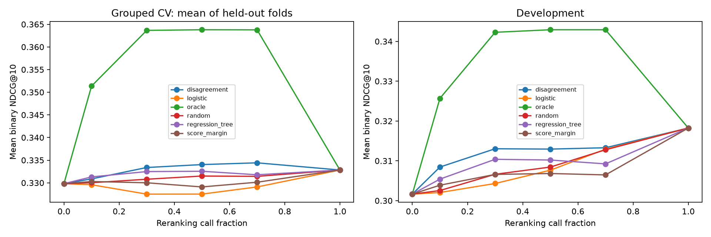
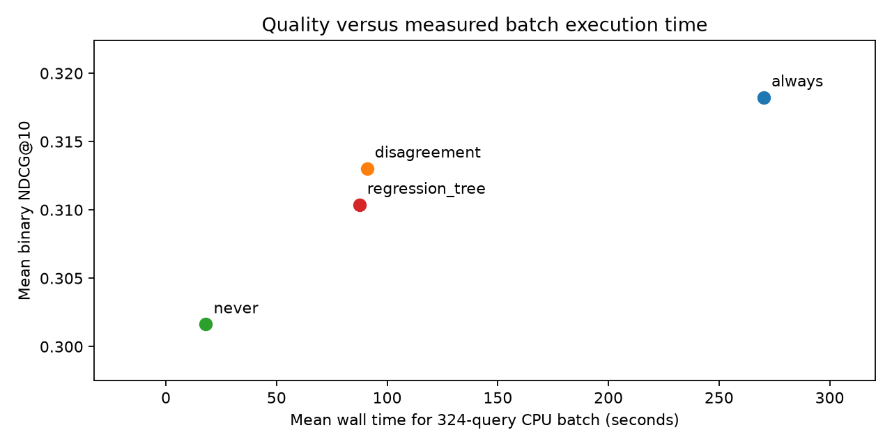

# SearchLab

**Selective neural reranking under a limited CPU budget — a completed feasibility study.**

Can a small model predict which search queries benefit from a cross-encoder, so a retrieval system can spend less compute without sacrificing quality?

SearchLab tested this question on NFCorpus. There was substantial oracle headroom, and a cheap retrieval-disagreement rule was useful. **The two trained routing models did not outperform that rule at the predefined 30% budget.** We completed the quality experiments, grouped validation, error analysis, and live CPU batch benchmarking, then closed the study rather than expanding the model search on the same development set.

## What we built

1. Checksummed dataset download and train/dev audit, including duplicate-query grouping and overlap exclusions.
2. Hybrid retrieval: BM25 top 100 and dense top 100, fused by reciprocal rank fusion into a fixed top-20 candidate pool.
3. Real CPU cross-encoder reranking of those same 20 documents, generating per-query quality gains and losses.
4. Never, Always, Random, score-margin, retrieval-disagreement, and two trained routing policies, plus a diagnostic oracle.
5. Three-fold grouped validation, paired group-bootstrap comparisons, saved predictions, and query-level error analysis.
6. A CPU benchmark with live query embedding, retrieval, routing, reranking, component timing, and batch timing.

Retrieval/reranking models are pretrained. The logistic and regression-tree routers are the models trained here. No vector database, GNN, expanded model search, or UI was added.

## Main results

Development: **324 queries**. Metric: **mean binary-relevance NDCG@10**. A 30% fixed budget selects `floor(0.3 * 324) = 97` queries.

| Policy | Reranking calls | NDCG@10 | Gain over Never |
|---|---:|---:|---:|
| Never | 0 | 0.301644 | — |
| Always | 324 | 0.318243 | +0.016599 |
| Random, mean of 10 seeds | 97 | 0.306626 | +0.004982 |
| RRF score margin | 97 | 0.306594 | +0.004950 |
| Retrieval disagreement | 97 | **0.313037** | **+0.011393** |
| Logistic regression | 97 | 0.304314 | +0.002670 |
| Regression tree, depth 3 | 97 | 0.310388 | +0.008744 |
| Oracle, diagnostic only | 97 | 0.342286 | +0.040642 |

All strategies use the same candidate pool. Oracle selects queries using actual gains and cannot be deployed. Its advantage does not come from finding additional documents.

Development gains: 113 positive, 127 zero, 84 negative. Positive gains averaged +0.118362; negative gains averaged -0.095200. Among zero-gain queries, 82 had no judged positive candidate. Unjudged does not necessarily mean irrelevant.

### Did learning beat a simple rule?

No. The primary criterion was improvement over disagreement at the same 30% budget.

| Learned minus disagreement | Dev difference | Conditional 95% group-bootstrap interval | CV folds with positive difference |
|---|---:|---|---:|
| Logistic regression | -0.008723 | [-0.017970, +0.000013] | 0 / 3 |
| Regression tree | -0.002649 | [-0.007747, +0.002082] | 1 / 3 |

Intervals resample fixed held-out query-group outcomes; they do not refit models or reselect budgets, and are unadjusted for multiple comparisons. Development is not a final unbiased test estimate.

Logistic regression selected 39 positive-gain queries but also 34 negative-gain queries. Disagreement selected 35 positive and only 11 negative queries. Predicting more positive cases did not produce better budget allocation. The tree selected 16 negative cases and did not use Jaccard overlap in its fitted splits. These are observed failure patterns, not proof of a single cause.



## CPU benchmark

The [CPU report](reports/cpu_benchmark.md) compares Never, Always, Disagreement, and Regression Tree on the same 324 queries. Two rounds reverse policy order, use the same seeded query order, and exclude model warmup. Models, BM25 index, and corpus embeddings are resident. Query embeddings, retrieval results, routing decisions, and cross-encoder scores are recomputed live.

| Policy | Mean wall time for 324-query batch | NDCG@10 |
|---|---:|---:|
| Never | 18.08 s | 0.301644 |
| Always | 270.18 s | 0.318243 |
| Disagreement @30% | 90.89 s | 0.313037 |
| Regression Tree @30% | 87.44 s | 0.310388 |

Disagreement used 70.06% fewer reranking calls and 66.36% less mean batch time than Always, with a 0.005206 lower NDCG. The small time difference between the two selective policies is not evidence that the trained router is inherently faster: selected-query mix and desktop timing noise differ. All 2,592 measured query executions preserved the original candidate pools and reproduced the offline quality scores.

**This is an exact-budget batch benchmark.** Selective policies need the full batch before selecting 97 calls. Observed completion latency includes the batch barrier and queue waiting. Active-service time excludes waiting and is a compute diagnostic, not directly measured online latency. The report provides both P50/P95 measurements and full batch wall times. Fewer calls must not be described as an equal percentage reduction in interactive latency.



## Why we stopped

There is a useful opportunity for selective reranking, but the fixed learned routers failed the main comparison. Logistic regression lost to disagreement in all three held-out training folds; the tree won one and lost two. Neither established development improvement over the heuristic. This is a negative result for the tested setup, not a claim that learned routing is impossible.

Further work would require new features, objectives, datasets, or model families. Repeatedly expanding that search on the same 324-query development set would increase selection bias and consume the time budget without a clear guarantee of a stronger ML result. We retained the simple baseline, measured the systems tradeoff, documented unsuccessful models, and ended the bounded study.

**Status: complete; no further model tuning planned.** Test judgments remain sealed. No final test-set, cross-dataset, production, or state-of-the-art claims are made.

## Experimental safeguards

- **Data:** 3,633 documents; 2,590 original train queries; 324 dev queries. Excluding six train queries in groups overlapping dev leaves 2,584 queries and 2,566 training groups.
- **Duplicates:** normalized exact matching and token-set Jaccard >= 0.85, grouped by connected components. This lexical procedure can miss semantic paraphrases.
- **Metric:** raw grades > 0 map to binary relevance 1; original grades are preserved. Train grades are all 1, while dev includes 1 and 2. IDCG uses all positive qrels. Unjudged documents score zero. Results are not directly comparable with graded BEIR leaderboard numbers.
- **Training:** three-fold GroupKFold; preprocessing fitted within training folds; no dev fitting. Only the predefined 12 pre-rerank features are allowed.
- **Routers:** StandardScaler plus LogisticRegression(C=1, max_iter=1000); DecisionTreeRegressor(max_depth=3, min_samples_leaf=20, random_state=42). Targets are gain > 1e-6 and continuous gain, respectively.
- **Inference:** fixed model commits; CPU FP32; maximum pair length 256; batch size 8 within a query; four intra-op and one inter-op thread.
- **Budgets:** 0%, 10%, 30%, 50%, 70%, 100%; floor rounding; document/query-ID tie breaks; random seeds 0–9. No hyperparameter search.
- **Test isolation:** only train/dev qrels are read. Test qrels remain inside the original archive throughout the study.

Dense model: `sentence-transformers/all-MiniLM-L6-v2` at `1110a243fdf4706b3f48f1d95db1a4f5529b4d41`. Cross-encoder: `cross-encoder/ms-marco-MiniLM-L2-v2` at `1b5cd67b15209f24824c50370e0397743aa9b787`. Dense search uses exact cosine similarity against a precomputed matrix. RRF uses equal weights and constant 60. See [fixed configuration](configs/experiment.json) and [routing protocol](configs/routing_protocol.json).

## Reproduce

Recorded environment: Windows 11, Python 3.12.14, Intel Core i7-10510U (4 cores / 8 threads, about 11.76 GiB physical RAM). Hardware, CPU frequency, background activity, and package versions affect timings. The dependency lock records the Windows CPU run; cross-platform bitwise reproduction is not promised.

```powershell
python -m venv .venv
.\.venv\Scripts\Activate.ps1
python -m pip install -r requirements.lock.txt --extra-index-url https://download.pytorch.org/whl/cpu
python scripts/download_data.py
python scripts/audit_data.py
python scripts/download_models.py
python scripts/test_metrics.py
python scripts/experiment.py retrieve
python scripts/experiment.py smoke
python scripts/experiment.py rerank
python scripts/experiment.py report
python scripts/validate_results.py
python scripts/train_routing.py
python scripts/validate_routing.py
python scripts/benchmark_cpu.py
python scripts/summarize_cpu.py
```

Downloads require network access; inference uses local assets. Dataset preparation never reads or extracts test qrels. CPU reranking saves per-query checkpoints: resume with the same `rerank` command and unchanged code/inputs. Fingerprints reject stale artifacts. The full CPU benchmark measures two rounds of all four policies. The PowerShell quality runner `scripts/run_experiment.ps1` is an alternative to the metric/retrieval/reranking/report steps.

## Reports and artifacts

- [Final research report](reports/final_report.md)
- [Gain feasibility results](reports/feasibility_results.md)
- [Grouped CV and learned routing results](reports/routing_results.md)
- [Query-level error analysis](reports/routing_error_analysis.md)
- [CPU benchmark and limitations](reports/cpu_benchmark.md)

CSV results, validation records, fixed protocols, and runtime metadata are included. Raw data, model weights, embeddings, serialized estimators, checkpoints, and Parquet outputs are excluded from Git. Running the workflow regenerates the local Parquet files under `experiments/`. The final report is a frozen narrative of the recorded run; regenerating intermediate reports can overwrite their manually added interpretation.

## Sources

- [BEIR dataset registry and checksums](https://github.com/beir-cellar/beir/wiki/Datasets-available)
- [NFCorpus source, usage terms, and citations](https://www.cl.uni-heidelberg.de/statnlpgroup/nfcorpus/)
- [Dense model card](https://huggingface.co/sentence-transformers/all-MiniLM-L6-v2)
- [Cross-encoder model card](https://huggingface.co/cross-encoder/ms-marco-MiniLM-L2-v2)

Dataset and model rights remain with their respective owners. Consult the original sources for applicable terms and citations. Data and weights are not redistributed here.
