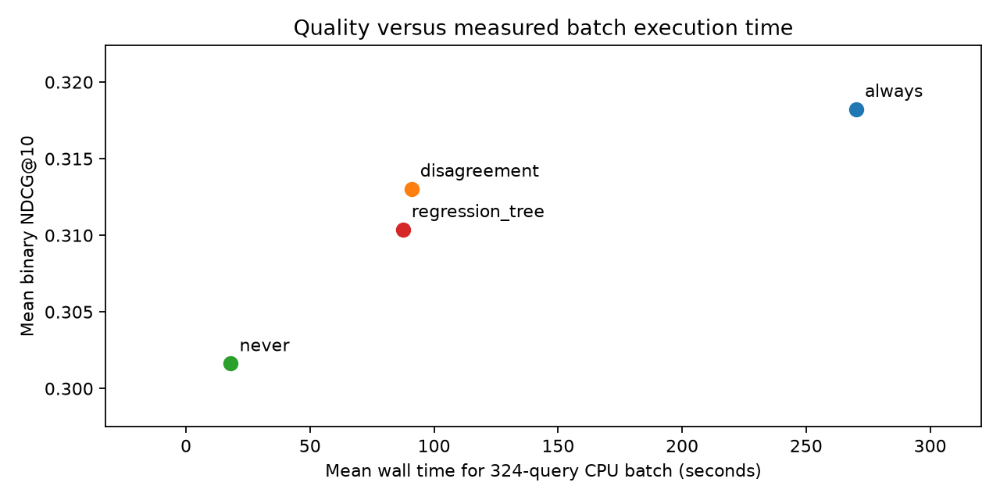

# CPU Benchmark

Measured on the 324 development queries with resident models, a resident BM25 index, and precomputed document embeddings. Every policy recomputes query embeddings, lexical retrieval, dense similarity, and RRF. No query results or cross-encoder scores are reused.

Two rounds use identical query order (seed 42) and reversed policy order. Eight training queries warm the pipeline before measurement. PyTorch uses CPU FP32, four intra-op and one inter-op thread, pair length 256, and batch size 8 within a query. Query embedding uses batch size 1. There is no cross-query model batching.

Machine: Intel64 Family 6 Model 142 Stepping 12, GenuineIntel; Windows-11-10.0.26200-SP0. Asset loading and index setup took 7.15 seconds and are excluded from steady-state measurements. Offline corpus embedding is a separate preparation cost.

## End-to-end measurements

Exact 30% allocation requires all query scores, so selective policies use a two-pass batch: retrieve the full workload, allocate 97 calls by score/query ID, then rerank selected queries. Always uses the same two-pass schedule; Never can complete each query immediately. Completion latency is observed directly from a query's first-stage start until its ranking is final, including barrier and queue waiting. This is a batch workload, not interactive online request latency.

Active-service time sums measured first-stage and reranking work plus amortized batch-allocation time. It excludes waiting and is reported as a compute diagnostic, not as directly measured online latency. Batch wall time includes the full timed workload. Percentiles pool 648 executions per policy across two rounds; two rounds do not establish statistical performance guarantees.

| Policy | NDCG@10 | Calls / 324 | Mean batch seconds | Completion P50 ms | Completion P95 ms | Active P50 ms | Active P95 ms |
|---|---:|---:|---:|---:|---:|---:|---:|
| always | 0.318243 | 324 | 270.18 | 128266.56 | 237608.03 | 767.70 | 1340.84 |
| disagreement | 0.313037 | 97 | 90.89 | 11806.84 | 64978.68 | 50.29 | 920.97 |
| never | 0.301644 | 0 | 18.08 | 37.63 | 130.26 | 37.60 | 130.24 |
| regression_tree | 0.310388 | 97 | 87.44 | 14069.94 | 58394.52 | 59.23 | 810.41 |

## Observed batch savings

- disagreement: 66.36% lower mean batch wall time than Always, with 70.06% fewer reranking calls. Quality differs because query selection differs.
- regression_tree: 67.64% lower mean batch wall time than Always, with 70.06% fewer reranking calls. Quality differs because query selection differs.

The policy-order reversal reduces one order effect but cannot remove thermal throttling, CPU frequency changes, background activity, or OS scheduling noise. A data-audit reproduction check overlapped part of the first Always trial; the second round followed its completion. No trial was discarded. These are descriptive desktop measurements, not an isolated-system microbenchmark. Savings describe this small corpus and this batch implementation. They do not establish online P95 improvements or cross-hardware generalization.

Component P50/P95 values, including query embedding, BM25, dense search, RRF, routing, and cross-encoder execution, are in cpu_benchmark_summary.csv. Component cross-encoder times include zero for skipped queries, so selective-policy P50 can be zero. Raw per-query records retain per-call timings. Raw per-round batch times are in cpu_benchmark_batches.csv. Component percentiles must not be added to obtain completion percentiles.

Validation checked all 2,592 query executions. Live candidate pools differing from the original quality experiment: 0. Live mean NDCG matches the offline experiment for each policy. Test judgments were not read.

