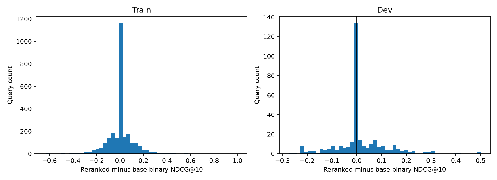
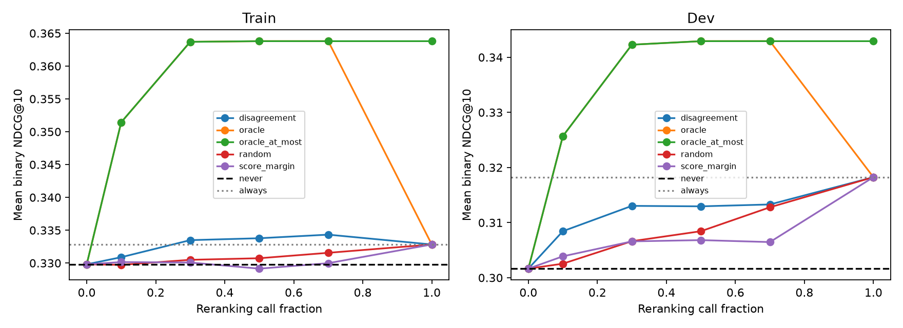

# Retrieval and Reranking Feasibility Results

Measured on eligible training queries and the development split. Test judgments were not accessed.

| Metric | Train | Dev |
|---|---:|---:|
| Queries | 2584 | 324 |
| Positive gain rate | 31.85% | 34.88% |
| Zero gain rate (absolute gain <= 1e-6) | 37.85% | 39.20% |
| Exact zero gain rate | 37.85% | 39.20% |
| Negative gain rate | 30.30% | 25.93% |
| Mean delta NDCG@10 | 0.003019 | 0.016599 |
| Never-rerank NDCG@10 | 0.329810 | 0.301644 |
| Always-rerank NDCG@10 | 0.332829 | 0.318243 |
| oracle @ 30%: NDCG@10 (gain over base) | 0.363696 (+0.033886) | 0.342286 (+0.040642) |
| oracle_at_most @ 30%: NDCG@10 (gain over base) | 0.363696 (+0.033886) | 0.342286 (+0.040642) |
| random @ 30%: NDCG@10 (gain over base) | 0.330495 (+0.000685) | 0.306626 (+0.004982) |
| score_margin @ 30%: NDCG@10 (gain over base) | 0.330084 (+0.000274) | 0.306594 (+0.004950) |
| disagreement @ 30%: NDCG@10 (gain over base) | 0.333491 (+0.003681) | 0.313037 (+0.011393) |

## Gain magnitude and zero-gain diagnostics

| Split | Category | Count | Mean gain | Median gain |
|---|---|---:|---:|---:|
| train | positive | 823 | 0.106704 | 0.080279 |
| train | zero | 978 | 0.000000 | 0.000000 |
| train | negative | 783 | -0.102191 | -0.078398 |
| dev | positive | 113 | 0.118362 | 0.091625 |
| dev | zero | 127 | 0.000000 | 0.000000 |
| dev | negative | 84 | -0.095200 | -0.083128 |

Train: 594 zero-gain queries have no judged positive document in the candidate pool. Query-level base quality and candidate coverage are preserved for further diagnosis.

Dev: 82 zero-gain queries have no judged positive document in the candidate pool. Query-level base quality and candidate coverage are preserved for further diagnosis.

The fixed 30% budget uses floor(0.3 * query_count): 775/2,584 training queries and 97/324 development queries. Random results average seeds 0–9. Score ties use ascending query ID. Oracle is diagnostic and uses observed gains. The at-most-budget oracle may select fewer queries.

Group-bootstrap intervals in policy_intervals.csv resample fixed query-level policy outcomes; they do not refit or reselect the budget in each replicate. Random intervals condition on the ten seeded selections; seed variability is also recorded in budget_curves.csv.

Reranking timings are diagnostic only. A controlled live end-to-end CPU benchmark and learned routing have not been performed.

## Interpretation

There are 1,606 nonzero-gain training queries, including 823 positive and 783 negative examples. Zero gains are common, but the observed training signal is not limited to a handful of queries. Of the 978 zero-gain training queries, 594 have no judged positive candidate, 81 already have perfect base NDCG, and 303 fall into other zero-gain cases. The corresponding development counts are 82, 7, and 38 out of 127 zero-gain queries. Absence of judged positives is a benchmark observation, not proof of semantic irrelevance.

At a 30% budget, the development oracle improves binary NDCG@10 by 0.040642 over the base ranking, compared with 0.016599 for reranking every query. This establishes selection headroom under the fixed candidate and model configuration; the oracle uses unavailable outcome information.

Retrieval disagreement improves development NDCG by 0.006411 over the ten-seed random mean. The conditional paired group-bootstrap 95% interval for that difference is [0.001054, 0.012586]. Score margin differs from random by -0.000032, with interval [-0.005370, 0.005100]. These development estimates support retrieval disagreement as the stronger simple baseline in this experiment. They are not final test-set estimates.

The evidence supports a bounded predictability experiment with the planned lightweight routing models. The next comparison should test whether learned routing improves on retrieval disagreement at the same budget. Model effectiveness and actual end-to-end speedups still require separate validation.

## Validation and artifacts

Eight hand-computed metric and ordering tests passed. An eight-query training smoke run verified finite scalar model outputs, 256-token pair limits, candidate preservation, and agreement between single-pair and batched inference. Persisted-output validation passed for all 2,908 queries, including fixed-budget counts, oracle dominance, and agreement of zero/full-budget endpoints with never/always reranking.

Local artifacts: `experiments/retrieval_results.parquet`, `experiments/query_gains.parquet`, model download manifests, retrieval/gain metadata, and per-query checkpoints. Summary tables and conditional intervals are saved in `gain_distribution.csv`, `budget_curves.csv`, `policy_intervals.csv`, and `result_validation.json`. Model revisions, CPU thread settings, package versions, and input/output hashes are recorded in the configuration, dependency lock, and metadata.

