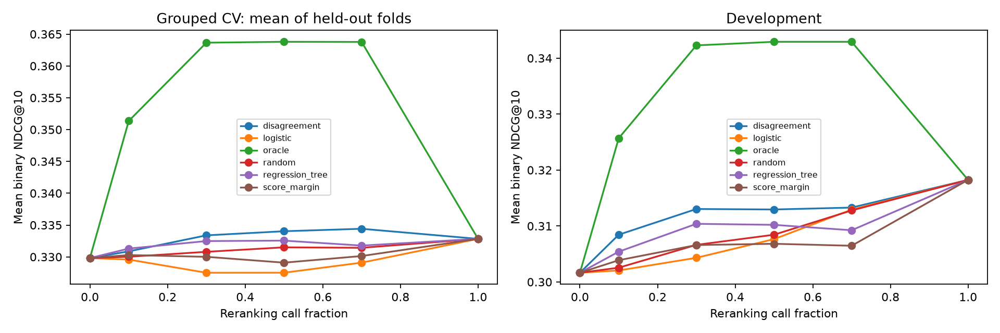

# Learned Routing Results

Fixed models and features; three-fold grouped training validation followed by full-training fit and development evaluation. No hyperparameter search or test-set access.

## Development at 30% budget

| Policy | NDCG@10 | Gain over base | Difference vs disagreement |
|---|---:|---:|---:|
| logistic | 0.304314 | +0.002670 | -0.008723 |
| regression_tree | 0.310388 | +0.008744 | -0.002649 |
| score_margin | 0.306594 | +0.004950 | -0.006443 |
| disagreement | 0.313037 | +0.011393 | +0.000000 |
| oracle | 0.342286 | +0.040642 | +0.029248 |
| random | 0.306626 | +0.004982 | -0.006411 |

## Primary comparison: learned minus disagreement

| Scope | Model | Difference at 30% | Conditional 95% interval |
|---|---|---:|---|
| cv_fold_1 | logistic | -0.006939 | [-0.012562, -0.001605] |
| cv_fold_1 | regression_tree | -0.000461 | [-0.004570, +0.003256] |
| cv_fold_2 | logistic | -0.006040 | [-0.011804, -0.000360] |
| cv_fold_2 | regression_tree | -0.002906 | [-0.007171, +0.001307] |
| cv_fold_3 | logistic | -0.004649 | [-0.009713, +0.000655] |
| cv_fold_3 | regression_tree | +0.000674 | [-0.002733, +0.004169] |
| dev | logistic | -0.008723 | [-0.017970, +0.000013] |
| dev | regression_tree | -0.002649 | [-0.007747, +0.002082] |

## Assessment

The predefined learned-predictability criterion is not met. At the primary 30% budget, both learned models have lower development point estimates than disagreement, and neither paired interval establishes an improvement. Logistic regression trails disagreement in all three held-out training folds; the regression tree wins one fold and loses two. The regression tree performs better than logistic regression on development, but this does not establish an advantage over the main heuristic.

The result supports retaining disagreement as the current routing baseline. Further feature or objective changes should be treated as a new exploratory experiment with a separately frozen protocol. Learned routing and live end-to-end speedups are not validated by this run.

Intervals use 1,000 paired duplicate-group resamples of fixed held-out outcomes. Models are not refitted and budget membership is not reselected within replicates. They condition on the fitted models and selected policies, and do not quantify training instability. Intervals are unadjusted for multiple comparisons. CV budgets are allocated separately within each held-out fold. The plot averages fold means; fold-level results remain in the CSV.

Random uses the original ten seeded query permutations, matching the feasibility experiment. Learned tie scores use ascending query ID. Tree leaves produce tied predictions, so budget-boundary selections follow this predefined rule.

The development set is repeatedly used development data, not a final unbiased test. Live end-to-end CPU latency remains unmeasured.

See routing_error_analysis.md for top predictions, harmful selections, missed gains, and selection differences from disagreement.
